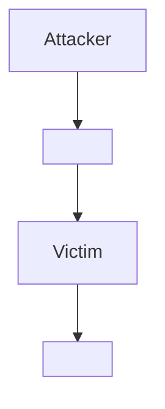

# <Incident name> (<Month YYYY>)

- **Date:** <DD Month YYYY>
- **Type:** <attack type>
- **Affected:** <who or what was affected>
- **Exposure window:** <if known>
- **Status:** <ongoing / contained / patched>

## TL;DR

<One paragraph: what the attacker did, who it reached, and the impact.>

## What happened

<Plain-language explanation. Introduce any technical term the first time it is used. Use an everyday comparison where it genuinely helps.>

## How the attack worked

## What the malicious code did

### 1. <Stage or capability>

<Details.>

## Timeline

| Time | Event |
|---|---|
| <time> | <event> |

## Recommendations

### For users

- <action>

### For organizations

- <action>

## Analysis

<What this incident shows and why it matters, in two or three short paragraphs.>

## Attribution

<Known, suspected or unknown, and how confident researchers are.>

## Glossary

| Term | Meaning |
|---|---|
| <term> | <meaning> |

## Indicators of compromise

Domains are defanged.

| Indicator | Role |
|---|---|
| `<domain[.]tld>` | <role> |

## Conflicting reports

- **<Topic>:** <how sources differ>

## Sources

- <Outlet>: [<Title>](<url>)

---

Last updated <DD Month YYYY>. Details may change as the investigation continues.

[Back to index](../../README.md)
