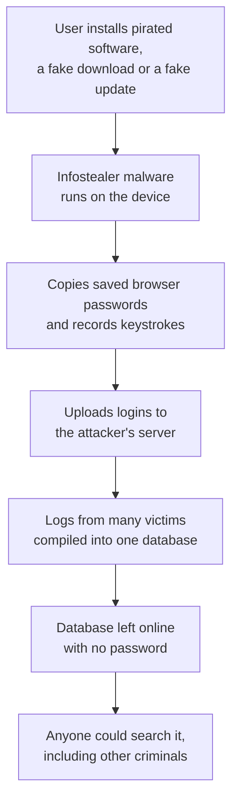

# 149 Million Stolen Logins Left in an Open Database (January 2026)

- **Date:** Reported 23 January 2026
- **Type:** Data exposure of credentials collected by infostealer malware
- **Affected:** About 149 million username and password records for Gmail, Facebook, Instagram, Netflix, Binance, government sites and others
- **Exposure window:** Unknown. The database stayed online for nearly a month after it was reported.
- **Status:** Taken offline by the hosting provider. The owner was never identified.

## TL;DR

Security researcher Jeremiah Fowler found a database on the internet holding 149,404,754 unique logins and passwords, with no password protecting it. Anyone with a web browser could search it. The data did not come from a breach at Google, Facebook or any other company. It was collected by infostealer malware running on ordinary people's computers and phones, which records logins as they are typed or saved in the browser. The database was still growing while Fowler was investigating it.

## What happened

An infostealer is a type of malware built to do one job: collect logins. It usually arrives through pirated software, fake downloads, malicious ads or fake "verify you are human" prompts (see the [ClickFix write-up](../2026-03-clickfix-fake-captcha/README.md)). Once running, it copies the passwords saved in the browser, and in some cases records keystrokes, then uploads everything to the attacker.

Each record in this database contained the web address of a login page, the username and the password. That is everything someone needs to log in. The records were organized so they could be searched by website, which suggests whoever built it was collecting and sorting logs from many infected machines.

The database was stored in a cloud storage container with no password. When Fowler reported it, the hosting provider said it did not host the address itself and that it belonged to a subsidiary operating independently. It took nearly a month and several attempts before the hosting was suspended. The provider never named the customer behind it.

A simple way to picture it: the burglar does not break into the bank. They watch over your shoulder every time you type your PIN, write it down, and then leave the notebook on a park bench.

## How the attack worked

### What was in it

Fowler's estimates by service:

| Service | Records |
|---|---|
| Gmail | 48 million |
| Facebook | 17 million |
| Instagram | 6.5 million |
| Yahoo | 4 million |
| Netflix | 3.4 million |
| Outlook | 1.5 million |
| .edu (education) accounts | 1.4 million |
| iCloud | 900,000 |
| TikTok | 780,000 |
| Binance | 420,000 |
| OnlyFans | 100,000 |
| Government (.gov) accounts | Several countries, number not published |

Binance said its own systems were not breached. The logins were stolen from users' infected devices.

## Timeline

| When | Event |
|---|---|
| Not published | Fowler discovers the database and reports it to the hosting provider |
| About one month later | Hosting provider suspends the database after several requests |
| 23 January 2026 | Fowler's findings published |

## Recommendations

### For users

- If you are worried your device is infected, scan it with reputable antivirus software first. Changing passwords on an infected device does not help, because the malware will capture the new ones too.
- After the device is clean, change important passwords, starting with email. Your email account can reset every other account.
- Turn on two-factor authentication or passkeys. A stolen password alone is then not enough to log in.
- Avoid pirated software, cracked games and "free" versions of paid apps. They are the most common way infostealers spread.
- Keep your operating system and security software updated, on phones as well as computers.
- Breach-notification services such as Have I Been Pwned can tell you whether your email appears in known leaks.

### For organizations

- Monitor infostealer log sources for employee and customer credentials, and force resets when they appear.
- Require multi-factor authentication, ideally phishing-resistant, for all staff accounts.
- Treat a login from an infostealer log as a sign the user's device is infected, not just that the password leaked.

## Analysis

This was not a breach of any of the companies whose names appear in the data. It shows how much of today's account theft starts on the victim's own device. Infostealer logs are bought, sold and combined into larger collections, and this one was left in the open. Fowler noted that it was not the first dataset of this kind he had found.

Because these logins come from live infections, they are often more current and more useful to criminals than old breach dumps. The fact that the record count grew during the investigation suggests malware was still feeding it.

## Attribution

Unknown. No owner was identified. Reporting describes the operator as suspected of criminal activity, although one outlet noted it could also have been a research collection.

## Glossary

| Term | Meaning |
|---|---|
| Infostealer | Malware that collects saved passwords, cookies and other login data from a device |
| Credential | A username and password, or other data used to log in |
| Keylogging | Recording what a user types |
| Two-factor authentication (2FA) | A second check at login, such as a code from an app, in addition to the password |
| Passkey | A login method that uses the device itself instead of a password |

## Conflicting reports

- **Size:** Reported as 94 GB (Cointelegraph image caption), 96 GB (Security Magazine, Fox News) and 98 GB (TechRadar).
- **Binance:** Some lists include 420,000 Binance logins; Security Magazine's list does not.
- **Purpose:** TechRadar says it could be an organized criminal or a research database. Security Magazine says the operator is suspected of criminal activity.

## Sources

- ExpressVPN (Jeremiah Fowler), original report: [149M Logins and Passwords Exposed Online](https://www.expressvpn.com/blog/149m-infostealer-data-exposed/)
- TechRadar: [Huge data leak of 149 million credentials exposed without any protection](https://www.techradar.com/pro/security/huge-data-leak-of-149-million-credentials-exposed-without-any-protection-98gb-of-unique-usernames-and-passwords-from-financial-services-social-media-accounts-and-dating-apps)
- Security Magazine: [149M Credentials Exposed](https://www.securitymagazine.com/articles/102095-149m-credentials-exposed-facebook-instagram-government-and-more-included)
- Cointelegraph: [Crypto Users Exposed in 149M Infostealer Data Dump](https://cointelegraph.com/news/crypto-users-affected-149m-infostealer-data-dump)
- Fox News: [149 million passwords exposed in massive credential leak](https://www.foxnews.com/tech/149-million-passwords-exposed-massive-credential-leak.amp)

---

Last updated 23 November 2026. Details may change as more information becomes available.

[Back to index](../../README.md)
