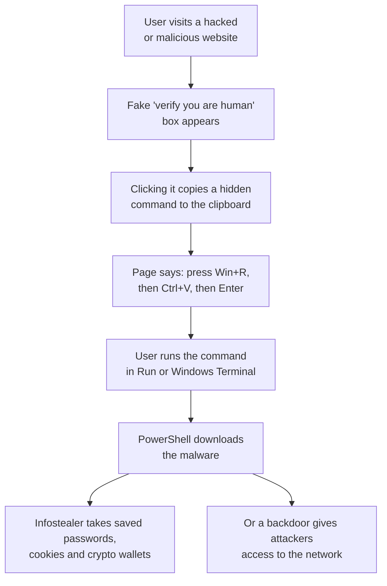
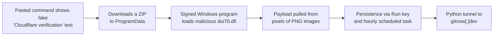

# ClickFix: Fake "Verify You Are Human" Attacks on Windows (2026)

- **Date:** Ongoing throughout 2026. Major Microsoft reports in March and August 2026.
- **Type:** Social engineering that tricks users into running malware themselves
- **Affected:** Windows users who visit compromised or malicious websites. Variants also target macOS.
- **Status:** Ongoing

## TL;DR

A website shows what looks like a normal "verify you are human" check. Instead of clicking pictures of traffic lights, it tells you to press a few keys, paste, and press Enter. What you paste is a hidden command that downloads malware, most often an infostealer that takes your saved passwords. No software vulnerability is involved. The victim runs the command, which is why antivirus and browser protections often miss it. ClickFix became one of the most widely used ways to infect Windows computers in 2026.

## What happened

ClickFix lures appear on hacked legitimate websites, fake download pages and malicious ads. The page shows an overlay that copies the look of a Cloudflare or Google check. When the visitor clicks the checkbox, the page silently copies a command to their clipboard. It then shows "verification steps":

1. Press **Windows + R** (or **Windows + X**, then **I**)
2. Press **Ctrl + V**
3. Press **Enter**

These keys open the Windows Run box or Windows Terminal, paste the attacker's command and run it. The command usually starts PowerShell, which downloads and runs the real malware. To the user, it looks like they completed a security check.

A simple way to picture it: a stranger at your door says "to prove you live here, read this card out loud to your smart speaker." The card says "unlock the front door."

## How the attack worked



### 2026 variants

Attackers kept changing the technique to get around new defenses.

| Variant | Reported | What was different |
|---|---|---|
| Run box with App-V abuse | January 2026 (The Hacker News) | Used a signed Microsoft script (`SyncAppvPublishingServer.vbs`) to look legitimate. Settings were hidden in a public Google Calendar file and the payload inside a PNG image. Installed the Amatera infostealer. |
| Windows Terminal | Observed February, reported March 2026 (Microsoft) | Told users to press Win+X then I to open Windows Terminal instead of the Run box, avoiding detections built for the Run box. Injected Lumma Stealer into Chrome and Edge to read saved logins. |
| TerminalFix | 28 August 2026 (Microsoft) | Fake Cloudflare Turnstile check. Used a legitimate signed Windows program to load a malicious DLL, hid the payload in image pixels, and installed a hidden Python tunnel that gave attackers ongoing access to the network. |

### TerminalFix step by step (Microsoft)



Microsoft said it did not observe ransomware or other follow-on actions in this chain, but the tunnel gives attackers a way into the victim's network.

## Scale

- The Hacker News reported that ClickFix accounted for 47% of attacks Microsoft observed in one reporting period. The period was not stated.
- Expel estimated that up to 147,521 systems were infected through one ClickFix-style campaign (ClearFake) since late August 2025.
- ClickFix page builders are sold on criminal forums for $200 to $1,500 a month, which makes the technique available to low-skill attackers.

## Timeline

| When | Event |
|---|---|
| October 2023 | First ClickFix-style lures observed |
| Late August 2025 | ClearFake infections begin, later estimated at up to 147,521 systems |
| January 2026 | App-V and Amatera variant reported |
| February 2026 | Microsoft observes the Windows Terminal and Lumma campaign |
| March 2026 | Apple adds a ClickFix mitigation to macOS (per Wikipedia, citing BleepingComputer) |
| 28 August 2026 | Microsoft publishes its TerminalFix analysis |
| October 2026 | Chrome adds a clipboard check against Safe Browsing (per Wikipedia, citing Google) |

## Recommendations

### For users

- A real CAPTCHA never asks you to press keys, open Run or Terminal, or paste anything. If a website asks you to, close it.
- If you already ran such a command: disconnect from the internet, run a full antivirus scan, and then change your passwords from a different, clean device. Sign out of all sessions on important accounts, since stealers take session cookies too.
- If you keep cryptocurrency on that computer, move it to a new wallet created on a clean device.

### For organizations

- Restrict the Run box and PowerShell for standard users through AppLocker, Windows Defender Application Control or Group Policy.
- Turn on PowerShell script block logging and Constrained Language Mode.
- Enable attack surface reduction rules, Defender network protection, SmartScreen and cloud-delivered protection.
- Alert on `LockScreenContentServer.exe` running outside `C:\Windows\SystemApps`.
- If a domain-joined machine is affected, treat it as a pivot point and rotate every credential it could reach.
- Include ClickFix examples in security awareness training. Users have been taught to trust CAPTCHAs.

## Analysis

ClickFix works because it turns the user into the delivery mechanism. Most security tools are built to stop malicious files and exploits. Here, a trusted user runs a trusted Windows tool. Every time defenders block one path, such as the Run box, attackers switch to another, such as Windows Terminal.

It also feeds the infostealer economy. Logins stolen through ClickFix are used to break into websites, which then host more ClickFix lures. Collections like the [149 million credential database](../2026-01-149m-infostealer-credentials/README.md) are the result.

## Attribution

ClickFix is a technique, not a single group. Many separate criminal operations use it, helped by ready-made kits sold on forums. Microsoft did not attribute the TerminalFix campaign.

## Glossary

| Term | Meaning |
|---|---|
| CAPTCHA | A test websites use to check that a visitor is human |
| Run box | The Windows dialog opened with Windows + R, which runs commands directly |
| PowerShell | A built-in Windows command and scripting tool |
| Infostealer | Malware that collects saved passwords, cookies and other login data |
| DLL sideloading | Tricking a legitimate program into loading a malicious library file |
| Steganography | Hiding data inside something else, such as an image |
| Reverse tunnel | A connection from the victim's machine out to the attacker, letting them reach the internal network |

## Indicators of compromise

Domains are defanged.

| Indicator | Role |
|---|---|
| `gitnow[.]dev` | TerminalFix command-and-control (port 443) |
| `bestsocialmedianewspapper[.]com`, `offlineupdater[.]com` | TerminalFix-related domains (Microsoft hunting query) |
| `gcdnb.pbrd[.]co`, `iili[.]io` | Amatera campaign domains |
| `C:\ProgramData\f47f2a8c21c9df4e` | TerminalFix install folder |
| `LockScreenContentServer.exe` with `dui70.dll` outside `SystemApps` | TerminalFix DLL sideloading |
| Scheduled task / Run key `LockScreenContentServer_MuODG5yBM` | TerminalFix persistence |

TerminalFix ZIP SHA-256:

```
18c2090e8a0ae0568af9b87e59eaf8270f23d2909600ed9db91a9444fd8b278f
```

## Conflicting reports

- **One campaign or several:** The Windows Terminal and Lumma chain (March) and TerminalFix (August) differ in tools and payloads. Sources do not say whether they are run by the same operators. This write-up treats them as separate.
- **The 47% figure:** Reported without a time period.

## Sources

- Microsoft Security Blog: [TerminalFix campaign deploys a reverse tunnel through multistage intrusion](https://www.microsoft.com/en-us/security/blog/2026/08/28/terminalfix-campaign-deploys-reverse-tunnel-through-multistage-intrusion/)
- The Hacker News: [Microsoft Reveals ClickFix Campaign Using Windows Terminal to Deploy Lumma Stealer](https://thehackernews.com/2026/03/microsoft-reveals-clickfix-campaign.html)
- The Hacker News: [ClickFix Attacks Expand Using Fake CAPTCHAs, Microsoft Scripts, and Trusted Web Services](https://thehackernews.com/2026/01/clickfix-attacks-expand-using-fake.html)
- Wikipedia: [ClickFix](https://en.wikipedia.org/wiki/ClickFix)

---

Last updated 23 November 2026. Details may change as new campaigns are reported.

[Back to index](../../README.md)
