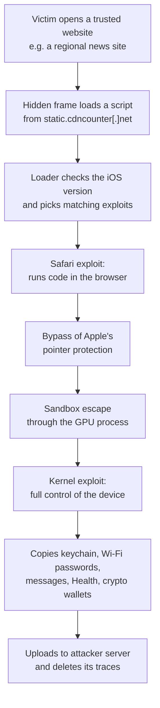

# DarkSword: iPhones Hacked by Visiting a Web Page (March 2026)

- **Date:** Disclosed 18 March 2026. In use since at least November 2025.
- **Type:** iPhone exploit kit delivered through compromised websites (watering-hole attack)
- **Affected:** iPhones running iOS 18.4 to 18.7 that opened an infected page in Safari. Campaigns were seen in Ukraine, Saudi Arabia, Turkey and Malaysia.
- **Status:** All six vulnerabilities patched. Update to iOS 26.3.1 or 18.7.6.

## TL;DR

DarkSword is a hacking toolkit that takes over an iPhone when its owner opens a booby-trapped web page in Safari. It chains six security flaws together to break out of the browser and reach the core of iOS. It then copies passwords from the keychain, saved Wi-Fi passwords, messages from SMS, WhatsApp and Telegram, call history, Health data, notes and crypto wallet data, uploads them, and cleans up after itself. It was used by a suspected Russian espionage group against people in Ukraine and by commercial spyware sellers. The same kit later appeared in the [Optimizely supply-chain attack](../2026-11-optimizely-supply-chain/README.md) in November 2026.

## What happened

A watering-hole attack targets the websites a group of people already trust and visit, instead of the people directly. In the Ukrainian campaign, attackers hacked a regional news site and a court website and added a hidden frame to their pages. That frame loaded a script from an attacker server, which only responded to visitors from Ukrainian internet addresses.

When an iPhone opened the page, the script checked the iOS version and loaded the matching set of exploits. Each exploit gets the attacker one step further: from running code inside Safari, past the browser's sandbox, into the GPU process, and finally into the iOS kernel, which controls the whole device.

DarkSword does not install a permanent app or file. It runs its data collection inside existing system processes, sends the data out, and deletes temporary files and crash reports. A restart removes it, but by then the data is already gone.

A simple way to picture it: a pickpocket waits at the coffee shop you visit every morning, takes what they want while you order, and leaves before you notice anything is missing.

## How the attack worked

### The six vulnerabilities

| Stage | CVE | Fixed in |
|---|---|---|
| Safari code execution (iOS 18.4 to 18.5) | CVE-2025-31277 | iOS 18.6 |
| Safari code execution (iOS 18.6) | CVE-2025-43529 | iOS 18.7.3 and 26.2 |
| Pointer authentication bypass | CVE-2026-20700 | iOS 26.3 |
| Sandbox escape (GPU, ANGLE) | CVE-2025-14174 | iOS 18.7.3 and 26.2 |
| Kernel memory bug | CVE-2025-43510 | iOS 18.7.2 and 26.1 |
| Kernel privilege escalation | CVE-2025-43520 | iOS 18.7.2 and 26.1 |

iVerify estimated that about 221 million iPhones were running the most-targeted iOS versions (18.4 to 18.6.2) when the kit was disclosed.

## Timeline

| When | Event |
|---|---|
| November 2025 | DarkSword used against Saudi users through a Snapchat-themed lure (per Google) |
| December 2025 | Ukraine watering-hole campaign begins |
| December 2025 to February 2026 | Apple fixes the six vulnerabilities across several updates |
| Early March 2026 | Google and iVerify disclose a related kit, Coruna |
| 18 March 2026 | DarkSword disclosed jointly by Google, iVerify and Lookout |
| 20 March 2026 | CISA adds three of the six vulnerabilities to its Known Exploited Vulnerabilities list |
| 16 November 2026 | DarkSword served to iPhone visitors in the Optimizely attack |

## Recommendations

### For users

- Update your iPhone: Settings > General > Software Update. iOS 26.3.1 or 18.7.6 fixes all six flaws.
- Turn on automatic updates so fixes install without waiting for you.
- If you are a journalist, activist, official or otherwise at higher risk, turn on Lockdown Mode (Settings > Privacy & Security > Lockdown Mode). iVerify says the chain would need extra bypasses to work against it.
- Restarting your phone regularly removes exploits like this one that do not survive a reboot. It does not undo data theft that already happened.

### For organizations

- Enforce minimum iOS versions for devices that access company data through mobile device management.
- Mobile threat detection tools can flag devices on vulnerable versions.
- Because the lure is a legitimate website, user training alone does not stop this kind of attack. Patching does.

## Analysis

DarkSword shows how quickly high-end iPhone exploits move from targeted espionage to wider use. The same kit was used by a state espionage group, a commercial spyware vendor and, months later, a criminal campaign that hit visitors of 178 major websites. Once an exploit chain exists, it gets reused.

The attack relied entirely on devices that had not been updated. Every vulnerability had a fix available before most of the campaigns were found.

## Attribution

Google tracked three separate users of the kit:

| Actor | Description | Targets | Payload name |
|---|---|---|---|
| UNC6353 | Suspected Russian state espionage group | Ukraine | GhostBlade |
| UNC6748 | Commercial surveillance vendor | Saudi Arabia | GhostKnife |
| PARS Defense | Turkish commercial surveillance vendor | Turkey, Malaysia | GhostSaber |

## Glossary

| Term | Meaning |
|---|---|
| Exploit kit | A packaged set of attacks against known vulnerabilities |
| Watering-hole attack | Hacking websites a target group already visits, instead of attacking the targets directly |
| Sandbox | A restricted area where an app runs so it cannot affect the rest of the device |
| Kernel | The core of the operating system, with full control of the device |
| Keychain | Where iOS stores saved passwords and other secrets |
| Lockdown Mode | An optional iOS mode that disables features commonly used by spyware |

## Indicators of compromise

Domains are defanged.

| Indicator | Role |
|---|---|
| `novosti[.]dn[.]ua` | Compromised website (watering hole) |
| `7aac[.]gov[.]ua` | Compromised website (watering hole) |
| `static[.]cdncounter[.]net` | Exploit delivery (`/widget.js`, `/assets/rce_loader.js`, `/pe_main.js`) |
| `sqwas[.]shapelie[.]com` | Data upload (ports 8881, 8882, path `/stats`) |

On-device artifacts: `/private/var/tmp/keychain-2.db`, `/private/var/tmp/wifi_passwords.txt`, `/private/var/tmp/icloud_dump/`, log tag `DarkSword-WIFI-DUMP`.

## Conflicting reports

- **User interaction:** iVerify calls it a one-click attack. SecurityWeek says "minimal user interaction". Lookout describes it as essentially zero-click.
- **Affected versions:** iVerify lists iOS 18.4 to 18.6.2. Google saw a variant also configured for iOS 18.7.
- **Number of devices:** iVerify estimates 221 million for 18.4 to 18.6.2 and 270 million for all of iOS 18. SecurityWeek quotes 296 million for all of iOS 18.

## Sources

- iVerify: [Inside DarkSword: A New iOS Exploit Kit Delivered Via Compromised Legitimate Websites](https://www.iverify.com/blog/darksword-ios-exploit-kit-explained)
- SecurityWeek: ['DarkSword' iOS Exploit Kit Used by State-Sponsored Hackers, Spyware Vendors](https://www.securityweek.com/darksword-ios-exploit-kit-used-by-state-sponsored-hackers-spyware-vendors/)
- Lookout: [DarkSword Exploit Kit](https://www.lookout.com/threat-intelligence/article/darksword-exploit-kit)
- Google Threat Intelligence Group: [DarkSword iOS exploit chain](https://cloud.google.com/blog/topics/threat-intelligence/darksword-ios-exploit-chain)

---

Last updated 23 November 2026.

[Back to index](../../README.md)
