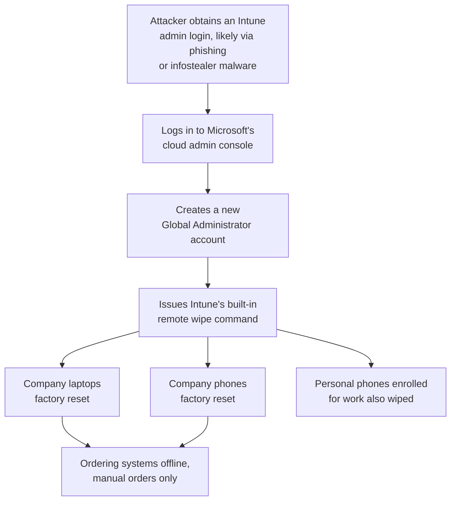

# Stryker: Tens of Thousands of Devices Wiped Without Malware (March 2026)

- **Date:** 11 March 2026
- **Type:** Destructive attack using a hijacked administrator account
- **Affected:** Stryker, a global medical technology company. Tens of thousands of employee laptops and phones were factory reset, reportedly including some personal phones enrolled for work.
- **Status:** Most operations restored by 1 April 2026

## TL;DR

Attackers took over an administrator account for Microsoft Intune, the system Stryker used to manage its employees' computers and phones. They created a new top-level admin account and used Intune's built-in "wipe" command to factory reset tens of thousands of devices around the world within hours. No malware and no software vulnerability were needed. An Iran-linked group called Handala claimed the attack, and Stryker's ordering systems went offline for days.

## What happened

Large companies use mobile device management tools like Intune to install software, enforce security settings and, if a laptop is lost or stolen, remotely erase it. That remote wipe is a legitimate safety feature. Whoever controls the admin console can send it to every enrolled device at once.

The attackers obtained the login of an Intune administrator. Researchers suggested phishing or infostealer malware as the likely way in. They then created a new Global Administrator account, the highest level of access in a Microsoft cloud environment, and issued wipe commands across the company.

On the morning of 11 March, employees in Stryker offices worldwide found their devices erased, with login screens showing the Handala logo. Electronic ordering went down, so hospitals and other customers had to place orders by phone through sales representatives. Stryker said its medical products remained safe to use and that the event was contained to its internal Microsoft environment.

Some employees had enrolled their personal phones in Intune to get work email. According to one analysis, those phones were wiped too, including authenticator apps people used for other accounts.

A simple way to picture it: a building's master key exists so security can open any door in an emergency. Someone stole the master key and used it to empty every office in one morning.

## How the attack worked

## Timeline

| When | Event |
|---|---|
| 11 March 2026, morning | Employees worldwide find devices wiped. One analysis puts the wipe between 05:00 and 08:00 UTC. |
| Following days | Stryker confirms the incident in an SEC 8-K filing |
| 20 March 2026 | US government attributes the attack to an arm of Iranian intelligence (reported by TechCrunch) |
| 1 April 2026 | Most operations restored |

## Recommendations

### For users

- Before enrolling a personal phone in your employer's device management, ask what the company can do to it. Where possible, use a separate work profile so only work data can be wiped.
- Keep backup codes for your authenticator app somewhere other than your phone, so losing the phone does not lock you out of everything.
- Back up personal photos and files to a service you control.

### For organizations

- Require a second administrator to approve destructive actions such as wipe, retire and delete. Intune supports multi-admin approval for this.
- Protect admin accounts with phishing-resistant MFA such as FIDO2 security keys.
- Use just-in-time access (Privileged Identity Management) so no one holds standing Global Administrator rights.
- Alert on creation of new Global Administrator accounts and on bulk device actions.
- Manage only a work profile on personal devices, not the whole device.
- Have an out-of-band way to communicate if company laptops and phones go down at once.

## Analysis

The Stryker attack did not need any hacking tools beyond a stolen login. It used a management feature exactly as designed. The more powerful a single admin account is, the more damage one compromised password can do. Controls such as multi-admin approval exist for this reason, but they only help if they are turned on.

It also showed a risk many employees do not think about: when you enroll a personal phone in work management, your employer's security becomes part of your phone's security.

## Attribution

Handala claimed the attack. Analysts describe Handala as a persona of an Iranian group tracked as Void Manticore (also known as Red Sandstorm and Banished Kitten), linked to Iran's Ministry of Intelligence and Security. The US government publicly attributed the attack to Iranian intelligence on 20 March.

## Glossary

| Term | Meaning |
|---|---|
| Mobile device management (MDM) | Software companies use to manage and secure employees' devices |
| Microsoft Intune | Microsoft's MDM service |
| Global Administrator | The highest level of admin access in a Microsoft cloud environment |
| Remote wipe | A command that erases a device from a distance |
| Wiper attack | An attack meant to destroy data rather than steal it or demand a ransom |
| BYOD | "Bring your own device": using personal devices for work |

## Conflicting reports

- **Number of devices:** Handala claimed more than 200,000 systems. A source quoted by BleepingComputer and TechRadar put it at almost 80,000.
- **Data theft:** Handala claimed 50 TB was stolen. TechRadar reports investigators found no evidence any data was taken.
- **Entry point:** Obsidian Security says phishing or infostealer malware is likely. Other sources say only that an admin account was compromised.
- **Personal phones:** Only Twin Networks reports personal devices being wiped.

## Sources

- TechRadar: [Stryker hackers allegedly wiped tens of thousands of devices without using any malware](https://www.techradar.com/pro/security/stryker-hackers-allegedly-wiped-tens-of-thousands-of-devices-without-using-any-malware)
- Obsidian Security: [Handala's Stryker Attack: How Iran-Linked Hackers Weaponized Microsoft Intune](https://www.obsidiansecurity.com/incident-watch/iran-hacktivist-group-handala-weaponizes-microsoft-intune)
- Twin Networks: [How Stryker Lost 200,000 Devices Without a Single Piece of Malware](https://twinnetworks.com/article-stryker)
- TechCrunch: [The worst hacks and breaches of 2026 so far](https://techcrunch.com/2026/09/15/the-worst-hacks-and-breaches-of-2026-so-far/)

---

Last updated 23 November 2026.

[Back to index](../../README.md)
