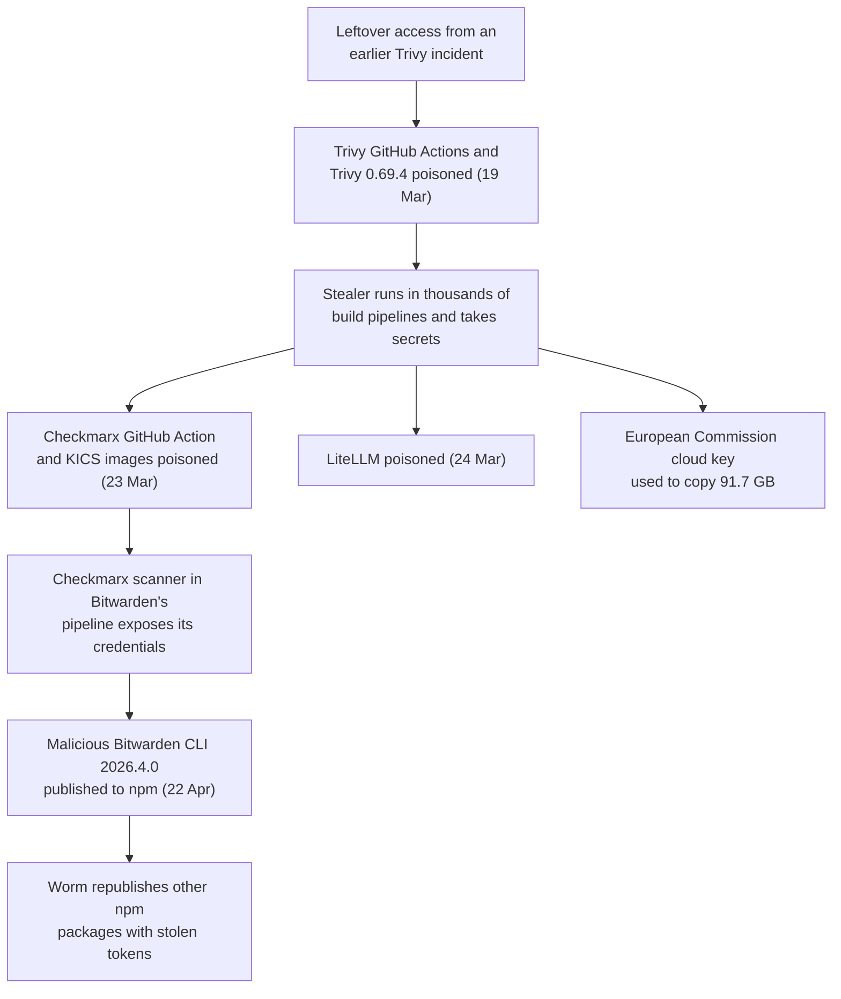

# TeamPCP: A Chain of Poisoned Developer Tools (March to May 2026)

- **Date:** 19 March to May 2026. Arrests announced 27 August 2026.
- **Type:** Software supply-chain attack on developer and security tools
- **Affected:** Developers and companies using Trivy, Checkmarx, LiteLLM, the Bitwarden command-line tool and other open-source packages. Downstream victims reportedly include the European Commission, OpenAI and GitHub.
- **Status:** Malicious versions removed. Suspects charged in Australia and the US.

## TL;DR

A group calling itself TeamPCP poisoned a series of popular developer tools. Each poisoned tool stole the passwords and access keys stored on the computers and build servers that ran it, and the attackers used those keys to poison the next tool. Over about two months the chain went from Trivy, a widely used security scanner, to Checkmarx's scanners, the LiteLLM AI library and the Bitwarden password manager's command-line tool, and on to break-ins at organizations including the European Commission. Bitwarden says users' password vaults were not affected.

## What happened

Most software is built by automated systems (CI/CD pipelines) that pull in dozens of open-source tools and run them with access to the company's secrets: cloud keys, publishing tokens and passwords. If one of those tools is poisoned, it runs with the same access.

**Trivy (19 March).** Using access left over from an earlier incident that had not been fully cleaned up, the attacker pushed malicious code to Trivy's GitHub Actions and released a trojaned Trivy version, 0.69.4. Developers usually refer to these actions by a version tag such as `v0.69`. Tags in Git can be moved, so the attacker pointed almost all existing tags at malicious code. Thousands of pipelines started running the attacker's stealer without changing anything.

**Checkmarx and LiteLLM (23 to 24 March).** Credentials stolen through Trivy were used to poison Checkmarx's GitHub Action and its KICS Docker images, and then LiteLLM, a popular AI library.

**European Commission (24 to 28 March).** Attackers used a stolen cloud key to access the Commission's cloud environment and copied about 91.7 GB of data, which was later published by the ShinyHunters group.

**Bitwarden CLI (22 April).** Bitwarden's build pipeline ran a Checkmarx scanner. Through the poisoned scanner, the attackers obtained Bitwarden's publishing credentials and released a malicious `@bitwarden/cli` version 2026.4.0 to npm. It was live for about an hour and a half. It contained a worm that used stolen npm tokens to publish infected versions of other packages the victim could publish.

**May.** A compiled timeline links further incidents to the same wave of stolen credentials, including TanStack packages, two OpenAI employee devices, the Nx Console editor extension and a breach of internal GitHub repositories.

A simple way to picture it: a thief poisons one ingredient at a food supplier. Every kitchen that uses it gets sick, and while staff are sick the thief copies their keys to the next supplier.

## How the attack worked



### What the stealer took

From every machine or pipeline that ran it, the malware collected:

- Environment variables, which often contain passwords and API keys
- Cloud credentials for AWS, Google Cloud and Azure
- Kubernetes secrets
- npm and GitHub tokens, which can publish software
- SSH keys and shell history
- Configuration files for AI coding assistants

The data was encrypted and sent to the attacker as a file named `tpcp.tar.gz`.

## Timeline

| When | Event |
|---|---|
| 19 March 2026 | Trivy GitHub Actions and Trivy 0.69.4 poisoned; removed the same day |
| 23 March 2026 | Checkmarx GitHub Action and KICS Docker images poisoned |
| 24 March 2026 | LiteLLM poisoned; European Commission detects suspicious activity |
| 28 March 2026 | European Commission data published by ShinyHunters |
| 22 April 2026 | Malicious Bitwarden CLI 2026.4.0 on npm for about 1.5 hours |
| 11 May 2026 | TanStack packages hit (42 packages, 84 versions) |
| 13 May 2026 | Two OpenAI employee devices affected |
| 18 May 2026 | Nx Console 18.95.0 extension published with malicious code |
| About 20 May 2026 | GitHub internal repository breach |
| 27 August 2026 | Two Western Australian men charged by the Australian Federal Police; an Australian man indicted in the US |

The May events and the arrests come from a compiled timeline by Nick O'Sullivan, citing official statements. The charges are allegations.

## Recommendations

### For users

- If you use Bitwarden through its normal apps or browser extension, Bitwarden says vault data was not affected. No action is needed.
- This attack targeted the tools used to build software, not apps on people's phones. Keeping your apps updated is still the best protection against downstream effects.

### For developers and organizations

- Pin GitHub Actions to a full commit SHA, not a version tag. Tags can be moved; commit hashes cannot.
- If you installed `@bitwarden/cli` 2026.4.0, uninstall it (`npm uninstall -g @bitwarden/cli`), clear the npm cache and rotate every GitHub, npm and cloud credential on that machine.
- If your pipelines ran the affected Trivy, Checkmarx or LiteLLM versions, rotate every secret they could access, including secrets those secrets could create.
- Use short-lived, least-privilege tokens and ephemeral build runners.
- Consider a minimum package age (the FBI suggested seven days) before new versions are used in builds, and use `ignore-scripts` for untrusted installs.
- On AWS, require IMDSv2 with a hop limit so build containers cannot read instance credentials.

## Analysis

This campaign worked like a chain reaction. Each victim's secrets became the key to the next victim. Security tools were especially valuable targets because they are trusted, run everywhere, and are given broad access to scan code.

It also showed how a small cleanup gap matters. The first compromise used access from an earlier Trivy incident that had not been fully remediated.

## Attribution

The attackers called themselves TeamPCP. On 27 August 2026, the Australian Federal Police charged two men from Western Australia, and the US Department of Justice indicted an Australian man in the Northern District of California. The European Commission data was published by ShinyHunters.

## Glossary

| Term | Meaning |
|---|---|
| Supply-chain attack | Compromising a shared supplier in order to reach its customers |
| CI/CD pipeline | Automated system that builds, tests and publishes software |
| GitHub Action | A reusable step in a GitHub build pipeline |
| npm | The main package registry for JavaScript software |
| Token | A secret that lets a program act as a user, such as publishing a package |
| Worm | Malware that spreads itself to new targets automatically |
| Commit SHA | A unique fingerprint of a specific version of code that cannot be changed |

## Indicators of compromise

Domains are defanged.

| Indicator | Role |
|---|---|
| `scan[.]aquasecurtiy[.]org` (45[.]148[.]10[.]212) | Trivy-wave data collection (note the misspelling) |
| `checkmarx[.]zone` (83[.]142[.]209[.]11) | Checkmarx-wave data collection |
| `audit[.]checkmarx[.]cx` (94[.]154[.]172[.]43) | Data collection, including Bitwarden wave |
| `models[.]litellm[.]cloud` | LiteLLM-wave infrastructure |
| `tpcp.tar.gz`, `tpcp-docs` repository | Exfiltration file and fallback repository |

Malicious versions: Trivy 0.69.4; LiteLLM 1.82.7 and 1.82.8; `Checkmarx/ast-github-action` 2.3.28; `@bitwarden/cli` 2026.4.0.

Bitwarden CLI payload SHA-256:

```
18f784b3bc9a0bcdcb1a8d7f51bc5f54323fc40cbd874119354ab609bef6e4cb   bw_setup.js
8605e365edf11160aad517c7d79a3b26b62290e5072ef97b102a01ddbb343f14   bw1.js
```

## Conflicting reports

- **Trivy tags:** Microsoft says 76 of 77 trivy-action tags were altered; Sysdig says 75 of 76.
- **Collection domain:** Sysdig lists `checkmarx[.]zone` for the Checkmarx wave; Microsoft and JFrog list `audit[.]checkmarx[.]cx`.
- **Encryption details:** Microsoft and JFrog describe the Bitwarden payload's encryption differently.
- **Scale:** Sysdig says "thousands of repositories"; the Australian Federal Police reportedly said "more than a thousand organisations". Neither figure is independently verified.

## Sources

- Microsoft Security Blog: [Guidance for detecting, investigating, and defending against the Trivy supply chain compromise](https://www.microsoft.com/en-us/security/blog/2026/03/24/detecting-investigating-defending-against-trivy-supply-chain-compromise/)
- Sysdig: [TeamPCP expands: Supply chain compromise spreads from Trivy to Checkmarx GitHub Actions](https://www.sysdig.com/blog/teampcp-expands-supply-chain-compromise-spreads-from-trivy-to-checkmarx-github-actions)
- JFrog Security Research: [TeamPCP Campaign Spreads to npm via a Hijacked Bitwarden CLI](https://research.jfrog.com/post/bitwarden-cli-hijack/)
- Nick O'Sullivan: [From Trivy to GitHub: how the TeamPCP supply-chain attacks spread](https://www.nickosullivan.id.au/posts/from-trivy-to-github-teampcp-blast-radius/)

---

Last updated 23 November 2026.

[Back to index](../../README.md)
