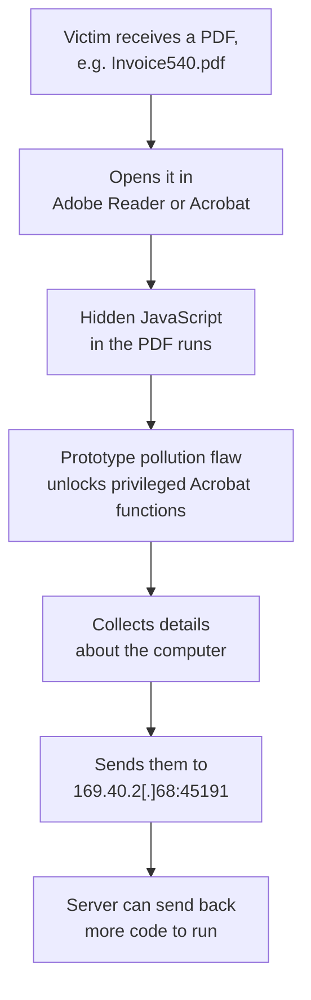

# Adobe Reader Zero-Day: Opening a PDF Was Enough (April 2026)

- **Date:** Patched 12 April 2026. Exploited since at least December 2025.
- **Type:** Zero-day vulnerability in a PDF reader
- **Affected:** Adobe Acrobat and Acrobat Reader on Windows and macOS
- **CVE:** CVE-2026-34621
- **Status:** Patched in Adobe security bulletin APSB26-43

## TL;DR

For at least four months, attackers sent PDF files that exploited an unknown flaw in Adobe Reader. Opening the file was enough. Hidden JavaScript inside the PDF abused the flaw to reach privileged parts of Acrobat, collected information about the computer and sent it to the attacker, who could then send back more code to run. A researcher found it after a sample was submitted to his detection service. Adobe released an emergency fix in April, and the US government ordered federal agencies to patch within two weeks.

## What happened

PDF files can contain JavaScript, which Acrobat uses for things like interactive forms. Normally that JavaScript is restricted from doing anything dangerous. This flaw, a type of bug called prototype pollution, let attacker code change how Acrobat's own JavaScript objects behave and use that to call privileged functions it should not have had access to.

The malicious PDFs were disguised as ordinary documents. One was named `Invoice540.pdf`. Later samples used Russian-language content about the oil and gas industry and gas supply disruptions, which suggests a targeted campaign.

When opened, the PDF ran obfuscated JavaScript that fingerprinted the computer and sent the details to a server controlled by the attacker. That server could reply with more JavaScript. The researcher could not trigger that next stage, so it is not confirmed what the attackers ran on victims' machines, but Adobe confirmed the flaw allows running arbitrary code with the user's permissions.

Haifei Li, founder of the exploit detection service EXPMON, found the attack after a sample was submitted to EXPMON. The first known sample had been uploaded to the VirusTotal malware-scanning site in November 2025, more than four months before the fix.

A simple way to picture it: a letter arrives that looks like a normal invoice. The moment you open the envelope, a hidden device inside quietly reports your address and waits for instructions.

## How the attack worked



### Affected and fixed versions

| Product | Affected | Fixed |
|---|---|---|
| Acrobat DC and Acrobat Reader DC (Windows, macOS) | 26.001.21367 and earlier | 26.001.21411 |
| Acrobat 2024 (Windows) | 24.001.30356 and earlier | 24.001.30362 |
| Acrobat 2024 (macOS) | 24.001.30356 and earlier | 24.001.30360 |

## Timeline

| When | Event |
|---|---|
| 28 November 2025 | First known malicious sample uploaded to VirusTotal |
| December 2025 | Exploitation in the wild under way |
| 23 March 2026 | Second sample uploaded to VirusTotal |
| 9 April 2026 | Haifei Li publishes details of the zero-day |
| 12 April 2026 | Adobe releases an emergency update and confirms in-the-wild exploitation |
| 13 April 2026 | CISA adds the flaw to its Known Exploited Vulnerabilities list, with a 27 April deadline for federal agencies |

## Recommendations

### For users

- Update Adobe Reader or Acrobat: open it, then go to Help > Check for Updates.
- Be careful with unexpected PDFs, especially invoices, shipping notices or documents from people you do not know.
- If you do not need Acrobat's interactive features, you can turn off JavaScript in PDFs: Edit > Preferences > JavaScript, then clear "Enable Acrobat JavaScript". This is general hardening, not an official fix.
- Opening unexpected PDFs in your browser's built-in viewer instead of Acrobat reduces exposure to Acrobat-specific bugs.

### For organizations

- Deploy the fixed versions as soon as possible.
- If patching is delayed, the researchers suggest blocking HTTP and HTTPS traffic with "Adobe Synchronizer" in the User-Agent header and monitoring endpoints for unusual changes.
- Consider disabling Acrobat JavaScript by policy where it is not needed.

## Analysis

This flaw was used for months before it was publicly identified, even though a sample had been sitting on VirusTotal since November. PDF readers are on almost every computer, and opening attachments is a normal part of work, which makes them a reliable target.

The Russian-language oil and gas lures suggest the attackers had specific targets in mind. Once a flaw like this is public, though, other attackers often start using it against anyone who has not updated.

## Attribution

Not named. Haifei Li indicated that an advanced, likely state-backed group is probably behind the attacks. The lures were written in Russian and focused on Russia's oil and gas sector.

## Glossary

| Term | Meaning |
|---|---|
| Zero-day | A vulnerability attackers use before the vendor knows about it or has a fix |
| Prototype pollution | A JavaScript bug where attacker code changes the shared templates other objects are built from |
| Arbitrary code execution | The attacker can run any code they choose on the victim's computer |
| Fingerprinting | Collecting details about a system to decide what to do next |
| CISA KEV | A US government list of vulnerabilities known to be exploited, which federal agencies must patch |

## Indicators of compromise

| Indicator | Role |
|---|---|
| `169.40.2[.]68:45191` | Command-and-control server |
| `Invoice540.pdf` | Malicious file name |
| User-Agent containing `Adobe Synchronizer` | Network traffic from the exploit |

Sample SHA-256 (taken from VirusTotal links in The Hacker News coverage):

```
54077a5b15638e354fa02318623775b7a1cc0e8c21e59bcbab333035369e377f   Invoice540.pdf
65dca34b04416f9a113f09718cbe51e11fd58e7287b7863e37f393ed4d25dde7   second sample
```

## Conflicting reports

- **Start of exploitation:** Help Net Security says November 2025. The Hacker News says at least December 2025, with the first sample uploaded on 28 November.
- **Severity:** The CVSS score was first given as 9.6, then revised to 8.6 when Adobe changed the attack vector from network to local.
- **Patch date:** Some reports give 11 April; Adobe's update and The Hacker News give 12 April.

## Sources

- The Hacker News: [Adobe Reader Zero-Day Exploited via Malicious PDFs Since December 2025](https://thehackernews.com/2026/04/adobe-reader-zero-day-exploited-via.html)
- The Hacker News: [Adobe Patches Actively Exploited Acrobat Reader Flaw CVE-2026-34621](https://thehackernews.com/2026/04/adobe-patches-actively-exploited.html)
- Help Net Security: [Adobe issues emergency fix for Acrobat Reader flaw exploited in the wild](https://www.helpnetsecurity.com/2026/04/13/adobe-acrobat-reader-cve-2026-34621-emergency-fix/)
- Adobe: [Security bulletin APSB26-43](https://helpx.adobe.com/security/products/acrobat/apsb26-43.html)

---

Last updated 23 November 2026.

[Back to index](../../README.md)
