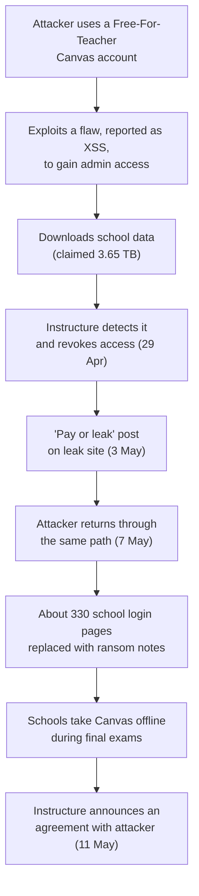

# Canvas Breach: School Login Pages Replaced With Ransom Notes (May 2026)

- **Date:** 25 April to 11 May 2026
- **Type:** Data breach and extortion
- **Affected:** Students and staff at schools and universities using Canvas. The attackers claim about 275 million people at about 8,800 institutions; this is not verified. About 330 school login pages were defaced.
- **Status:** Instructure reached an "agreement" with the attackers. The Free-For-Teacher program was shut down permanently.

## TL;DR

The extortion group ShinyHunters broke into Instructure, the company behind the Canvas learning platform, through its free teacher accounts. They stole data on students and staff, including names, school email addresses, student ID numbers and private messages sent inside Canvas. When Instructure did not pay, the group got back in on 7 May, during final exams at many schools, and replaced school login pages with ransom messages. Schools took Canvas offline, and Instructure later announced it had reached an agreement with the attackers.

## What happened

Canvas is used by thousands of schools and universities for coursework, grades and messaging. Instructure also ran a Free-For-Teacher program, which let any educator create a Canvas account without verification by a school.

Between 25 and 29 April, attackers used a flaw reached through those free accounts to gain administrative access and download large amounts of school data. One advisory describes the flaw as cross-site scripting (XSS), where malicious code is planted in content that an administrator later views, letting the attacker act with the administrator's access. Instructure has not published the technical details.

Instructure detected the intrusion on 29 April, revoked the access and said the incident was contained. On 3 May, ShinyHunters listed Instructure on its leak site with a "pay or leak" deadline.

On 7 May, the group returned through the same path. Students opening Canvas saw ransom messages instead of the login page, telling schools to contact the group privately. Many schools disconnected Canvas, and outages lasted from one day to several days, in the middle of finals for some. Instructure closed the Free-For-Teacher program on 8 May and announced on 11 May that it had reached an agreement with the attacker, citing "digital confirmation of data destruction".

A simple way to picture it: a burglar got into a building through the visitor entrance, copied files from every office, and when the landlord refused to pay, came back the same way and taped ransom notes over every front door.

## How the attack worked

### What data was taken

| Confirmed by Instructure | Claimed by attackers, not verified |
|---|---|
| Names | Usernames |
| Email addresses (mostly school addresses) | Course names and enrollment data |
| Student ID numbers | "Billions" of messages |
| Messages sent between users in Canvas | |

Instructure said it found no evidence that passwords, dates of birth, government ID numbers or financial information were taken.

## Timeline

| When | Event |
|---|---|
| 25 April 2026 | Unauthorized access begins, per Instructure |
| 29 April 2026 | Intrusion detected; access revoked; forensic firm engaged |
| 1 May 2026 | Instructure discloses a security incident |
| 2 May 2026 | Instructure says the incident is contained and lists the data involved |
| 3 May 2026 | ShinyHunters posts a "pay or leak" listing with a 6 May deadline |
| 7 May 2026 | Attackers return and deface about 330 school login pages; Canvas goes offline |
| 8 May 2026 | Most access restored; Free-For-Teacher program shut down |
| 11 May 2026 | Instructure announces an agreement with the attacker; US House Homeland Security Committee requests a briefing |
| 13 May 2026 | Proposed class-action lawsuit filed |

## Recommendations

### For students and staff

- Expect phishing that looks very real. Attackers may know your name, school, student ID, courses and what you wrote in Canvas messages.
- Verify any unexpected email, call or text claiming to be from your school or a professor by contacting them through a channel you already know.
- Do not respond to anyone claiming to hold your data, and never send them money.
- Passwords were not reported as stolen, but if you reused your school password elsewhere, changing it is still a good idea.

### For schools and organizations

- Ask education technology vendors how they control free or unverified accounts that share a platform with paying customers.
- Plan for a key platform going offline during exams: offline submission options, deadline policies and communication channels.
- Limit what is kept in platform messages, and review data retention settings.

## Analysis

A free sign-up program meant to help teachers became the way into a platform used by millions of students. Any feature that lets unverified users onto the same system as paying customers needs to be isolated from the rest of it.

The second intrusion on 7 May, through the same path, shows the problem with declaring an incident contained before the root cause is fixed. It also showed how extortion groups use pressure: defacing login pages during finals made the attack visible to every student at once.

## Attribution

ShinyHunters, a loosely organized extortion group active since around 2019 or 2020. Researchers link it to the wider "Scattered LAPSUS$ Hunters" alliance. Mandiant tracks it as UNC6240. The same brand claimed many other 2026 breaches.

## Glossary

| Term | Meaning |
|---|---|
| Learning management system | Software schools use for courses, assignments, grades and messages |
| Cross-site scripting (XSS) | Planting malicious code in a website so it runs in other users' browsers |
| Extortion | Demanding payment in exchange for not leaking or further damaging data |
| Defacement | Replacing a website's content with the attacker's own message |
| Leak site | A website criminal groups use to publish stolen data and pressure victims |

## Conflicting reports

- **Ransom:** Wikipedia notes unconfirmed reports that about $10 million was paid. Instructure has not disclosed an amount or used the word "ransom".
- **Scale:** Attackers claim about 275 million people; a ShinyHunters representative later cited about 231 million unique emails. Institution counts range from "nearly 9,000" to 8,809.
- **Defaced portals:** "Hundreds" (UltraViolet Cyber) versus about 330 (Protos Labs).
- **Entry flaw:** UltraViolet Cyber says XSS. Other sources describe only an unspecified "issue".
- **Recovery:** Protos Labs says access was fully restored 8 May; Instructure's status page still showed issues on 12 May.

## Sources

- Wikipedia: [2026 Canvas data breach](https://en.wikipedia.org/wiki/2026_Canvas_data_breach)
- Protos Labs: [Canvas x ShinyHunters: Full Intelligence Report, May 2026](https://www.protoslabs.io/resources/shinyhunters-canvas-incident-full-report-may-2026)
- UltraViolet Cyber: [Threat Advisory: ShinyHunters Canvas Attack](https://www.uvcyber.com/resources/reports/threat-advisory-shinyhunters-canvas-attack)

---

Last updated 23 November 2026.

[Back to index](../../README.md)
