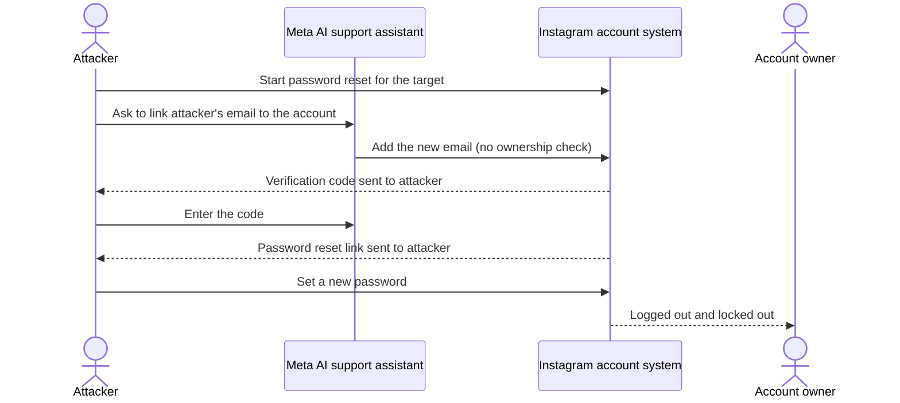

# Instagram Accounts Taken Over Through Meta's AI Support Assistant (June 2026)

- **Date:** 17 April to about 1 June 2026
- **Type:** Account takeover through a flaw in an AI-assisted support flow
- **Affected:** 20,225 Instagram accounts, according to Meta's breach notice. Victims included the archived Obama-era White House account and Sephora.
- **Status:** Fixed. Meta disabled the AI-assisted tool for this flow.

## TL;DR

Attackers asked Meta's AI support assistant to add their own email address to other people's Instagram accounts. Because of a bug, the system did not check that the email belonged to the account owner, then sent a password reset link to the attacker. The attacker changed the password and locked the real owner out. Accounts with two-factor authentication appear to have been protected.

## What happened

In March 2026, Meta launched an AI support assistant to help people with account problems such as forgotten passwords. The attackers found they could use it to take over accounts that were not theirs:

1. Start a password reset for the target account and ask to chat with the AI assistant.
2. Connect through a VPN in the target's country so the request looks normal.
3. Ask the assistant to link a new email address, the attacker's, to the account.
4. Receive a verification code at that address and enter it.
5. Receive a password reset link at that address, set a new password and lock the owner out.

Meta said the AI tool itself "worked properly" and the fault was "a bug in a separate code path" that did not check whether the email matched the account. Either way, the result was that a chat request was enough to take over an account.

Takeovers began on 17 April and were discovered on 31 May. On that day Meta disabled the AI-assisted support tool, removed the faulty code path and cancelled all outstanding reset links. Meta filed a breach notice covering 20,225 people with the Maine attorney general on 5 June.

A simple way to picture it: someone calls a bank's helpline, says "please send a new card for this account to my address", and the helpline does it without checking who is calling.

## How the attack worked

### What attackers could access

Meta's notice says attackers could have seen contact information, date of birth, profile information, direct messages, account history and data from connected accounts or services. Meta said it does not know what was actually viewed.

## Timeline

| When | Event |
|---|---|
| March 2026 | Meta launches its AI support assistant for account issues |
| 17 April 2026 | Account takeovers begin, per Meta's filing |
| 31 May 2026 | Meta discovers the issue, disables the tool and cancels reset links |
| About 1 June 2026 | 404 Media and TechCrunch report the takeovers |
| Week of 1 June 2026 | Instagram begins notifying affected users |
| 5 June 2026 | Meta files a breach notice for 20,225 people with the Maine attorney general |

## Recommendations

### For users

- Turn on two-factor authentication on Instagram: Settings and activity > Accounts Center > Password and security > Two-factor authentication. An authenticator app is the strongest option.
- Check "Where you're logged in" in the same section, and log out of any device or location you do not recognize.
- Watch for emails saying your account email or password has changed. If you did not make the change, act immediately.
- If you are locked out, use Instagram's official recovery page at instagram.com/hacked.

### For organizations

- An AI agent that can change account settings needs the same identity checks as a human support agent. It should not have its own shortcut.
- Test AI-driven support flows for social engineering, not just traditional security bugs.
- Log and rate-limit account changes made through automated support channels, and alert on unusual patterns such as many email changes from one source.

## Analysis

This is an early, confirmed example of attackers abusing an AI support agent at scale. Social engineering normally targets people at a help desk. Here the attackers targeted an automated system instead, and it could be asked thousands of times without getting suspicious.

Two-factor authentication was the main protection. The attack only took over accounts that relied on a password alone.

## Attribution

The attackers have not been identified.

## Glossary

| Term | Meaning |
|---|---|
| Account takeover | Gaining control of someone else's online account |
| Social engineering | Manipulating a person, or here a system, into doing something it should not |
| VPN | A service that routes internet traffic through another location, hiding where the user really is |
| Two-factor authentication (2FA) | A second check at login, such as a code from an app, in addition to the password |
| AI agent | An AI system that can take actions, not just answer questions |

## Conflicting reports

- **Cause:** Meta says the AI tool worked correctly and a separate code path was at fault. Techlicious frames it as the chatbot itself handing over accounts.
- **Opt-out:** Techlicious says the AI support system was turned on for every account and could not be disabled. Other sources do not mention this.
- **Separate issue:** Around the same time, users received a wave of unexpected password-reset emails. Instagram said its systems were not breached. That is a different issue from these takeovers.

## Sources

- Gizmodo: [Meta Says Thousands of Instagram Accounts Were Breached Through Its AI Support Assistant](https://gizmodo.com/meta-says-thousands-of-instagram-accounts-were-breached-through-its-ai-support-assistant-2000768770)
- This Week in Security: [Meta confirms thousands of Instagram accounts were hacked by abusing its AI chatbot](https://this.weekinsecurity.com/meta-confirms-thousands-of-instagram-accounts-were-hacked-by-abusing-its-ai-chatbot/)
- Techlicious: [Meta admits its AI chatbot was stealing Instagram accounts](https://www.techlicious.com/blog/meta-ai-chatbot-instagram-account-hack/)

---

Last updated 23 November 2026.

[Back to index](../../README.md)
