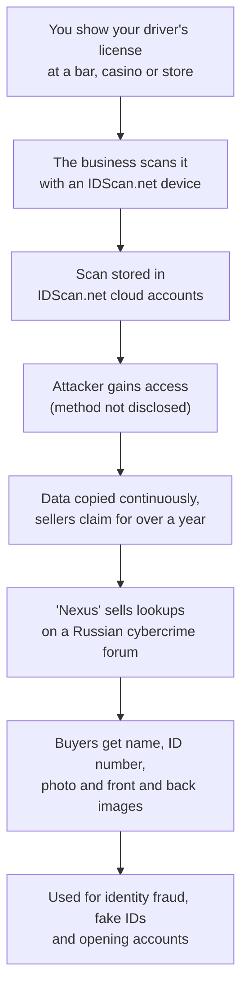

# IDScan: 153 Million Driver's Licenses Sold Online (September 2026)

- **Date:** Exposed 1 September 2026. The sellers claimed they had been collecting data for over a year.
- **Type:** Data breach, with stolen data sold on a criminal marketplace
- **Affected:** People whose IDs were scanned by businesses using IDScan.net. The sellers claimed more than 153 million US and Canadian driver's licenses, 10 million ID cards, 3 million travel documents and 579,000 medical cards.
- **Status:** FBI investigating. IDScan.net says an unauthorized party may have accessed its cloud accounts.

## TL;DR

A criminal service called "Nexus" sold searchable access to more than 153 million scanned US and Canadian driver's licenses, including photos and images of both sides. Journalist Brian Krebs traced the data to IDScan.net, a company whose scanners businesses such as bars, casinos and stores use to check IDs at the door. IDScan later said an unauthorized party may have accessed and copied data in its cloud accounts. The database grew by nearly 400,000 records in a single day while Krebs was watching.

## What happened

When a business scans your driver's license to check your age or identity, the scan often goes to the ID-verification company that provides the scanner. IDScan.net, based in New Orleans, is one of the largest. Its own 2025 report said it held more than 150 million license records.

On 31 August, a source alerted Krebs to a Nexus listing on Exploit, a Russian-language cybercrime forum. As a free sample, the seller offered Krebs his own driver's license. Each record included the person's name, license or ID number, scans of the front and back, photos and timestamps. Krebs checked the data against records of people who agreed to be looked up and traced it back to IDScan.net.

Krebs published on 1 September. The FBI's New Orleans field office opened an investigation the same day, and the Nexus site disappeared that evening. On 4 September, IDScan posted a notice saying an unauthorized third party "may have accessed and/or copied" customer information in its cloud accounts, and offered free credit monitoring. How the attackers got in has not been disclosed.

A simple way to picture it: every time you showed your ID at a club, a copy went into a filing cabinet. Someone has been quietly photocopying that cabinet for a year and selling the copies.

## How the attack worked

## Timeline

| When | Event |
|---|---|
| About a year before disclosure | Data collection begins, according to the sellers |
| 31 August 2026 | Source alerts Krebs to the Nexus listing |
| 1 September 2026 | Krebs publishes; FBI New Orleans opens an investigation; Nexus site goes offline |
| 2 September 2026 | Caesars says it has not been an IDScan client since February 2025 |
| 4 September 2026 | IDScan.net posts a breach notice |
| 10 September 2026 | TechCrunch reports IDScan's confirmation |

## Recommendations

### For users

- If you are in the US, freeze your credit with Equifax, Experian and TransUnion. It is free and stops new credit accounts from being opened in your name. Canadians can contact Equifax Canada and TransUnion Canada.
- If you receive a notice from IDScan.net, sign up for the free credit monitoring it offers.
- Check your credit reports for accounts you did not open.
- Be suspicious of messages that quote your license number or address to seem legitimate.
- You can ask businesses whether they store ID scans or only check them. Many only need to confirm your age.

### For organizations

- Collect only what you need. If the goal is to confirm age, check the ID and discard the scan.
- Ask ID-verification vendors how long they keep data, where it is stored and who can access it.
- Treat stored identity documents as high-risk data, with strong access controls and monitoring for bulk downloads.

## Analysis

Most people do not know their ID is being stored when it is scanned at a door. Unlike a password, a driver's license number and photo cannot easily be changed, so this kind of data stays useful to criminals for years.

The breach also shows the risk of large data stores built for convenience. One vendor serving many businesses became a single place where over 150 million identity documents could be stolen at once.

## Attribution

The people behind Nexus have not been identified, and no arrests have been reported. The FBI is investigating, and IDScan says it is cooperating with federal law enforcement.

## Glossary

| Term | Meaning |
|---|---|
| ID verification | Checking that an identity document is real and belongs to the person presenting it |
| Credit freeze | A free block on your credit file that stops new accounts being opened in your name |
| Identity fraud | Using someone else's personal details to open accounts or commit crimes |
| Cybercrime forum | An online marketplace where criminals buy and sell stolen data and tools |

## Conflicting reports

- **Stolen or possibly accessed:** TechCrunch says hackers stole the licenses. IDScan says only that a third party "may have accessed and/or copied" data.
- **Passports:** TechCrunch says the data includes passports. Krebs says there are no passports in the data set.
- **Photos:** Krebs and TechCrunch describe photos and images. IDScan's notice lists only names and ID numbers.
- **Number of people:** Nexus advertised more than 170 million people. IDScan has not said how many individuals were affected.

## Sources

- Krebs on Security: [FBI Probes Service Selling 153M+ Drivers Licenses](https://krebsonsecurity.com/2026/09/fbi-probes-service-selling-153m-drivers-licenses/)
- TechCrunch: [ID verification giant IDScan confirms data breach with more than 150 million driver's licenses stolen](https://techcrunch.com/2026/09/10/id-verification-giant-idscan-confirms-data-breach-with-more-than-150-million-drivers-licenses-stolen/)
- Help Net Security: [IDScan confirms breach after 153 million driver's licenses leak on dark web](https://www.helpnetsecurity.com/2026/09/11/idscan-net-data-breach-153-million-drivers-licenses/)

---

Last updated 23 November 2026.

[Back to index](../../README.md)
