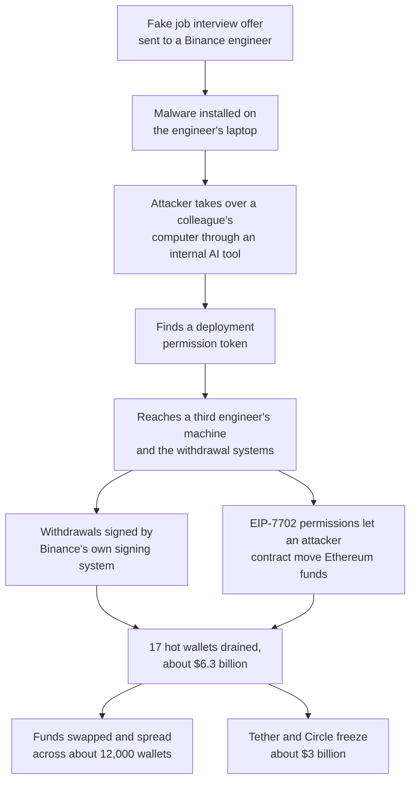

# Binance: $6.3 Billion Stolen in the Largest Crypto Theft on Record (October 2026)

- **Date:** 29 October 2026
- **Type:** Cryptocurrency theft through compromised employee computers
- **Affected:** Binance hot wallets on about ten blockchains. Roughly $6.3 billion taken.
- **Status:** Binance covered all customer losses. About $3 billion frozen. Attributed to North Korea, which denies it.

## TL;DR

Attackers drained about $6.3 billion from Binance's hot wallets in a few hours, more than four times the previous record (Bybit, $1.5 billion in 2025). According to Binance, the attack started months earlier with malware on engineers' laptops, including one infected through a fake job interview. That access eventually let the attacker use Binance's own systems to approve withdrawals. Binance covered all customer losses from company funds, and stablecoin issuers froze about $3 billion. Blockchain analysts and the FBI attributed the theft to North Korea's TraderTraitor group.

## What happened

Crypto exchanges keep most customer funds in offline "cold" wallets and a smaller amount in online "hot" wallets for day-to-day withdrawals. Withdrawals from hot wallets are approved by an internal signing system.

Binance's first update said a DevOps engineer's laptop had been compromised, giving the attacker access to an internal service container from which they submitted unauthorized withdrawals. It said there was no evidence of a wallet private key leak.

Binance's later post-mortem, as summarized on Wikipedia, described a longer chain:

- In June, the attacker infected an engineer's machine. It was detected and cleaned, but the attacker had already learned how roles were organized.
- In September, a second engineer received a fake job interview offer and installed malware that was not detected.
- The attacker used that machine to take over the first engineer's computer through an internal AI tool, found a deployment permission token there, and used it to reach a third engineer's machine.
- From there, the attacker could get withdrawals approved by Binance's own signing system.

On the evening of 29 October (UTC), funds started leaving 17 hot wallets. On Ethereum, the attacker had also used a feature called EIP-7702 to give an attacker-controlled contract permissions over a hot wallet. Because those permissions were already recorded on the blockchain, pausing withdrawals on Binance's side did not stop the transfers.

The attacker quickly swapped $729 million in stablecoins before they could be frozen and spread funds across about 12,000 wallets. Tether and Circle froze what they could. Binance removed the attacker's permissions just after midnight UTC and resumed withdrawals on 1 November.

A simple way to picture it: a thief spends months getting a job badge for each department, one at a time, until they can sign the bank's own withdrawal forms.

## How the attack worked

## Timeline

All times UTC.

| When | Event |
|---|---|
| June 2026 | First engineer's machine infected and cleaned (per Binance post-mortem) |
| September 2026 | Second engineer infected through a fake job interview |
| 29 Oct, about 20:04 | First unauthorized transfers |
| 29 Oct, 21:01 to 21:04 | Tether and Circle begin freezing funds |
| 29 Oct, 21:29 | Binance says it is investigating and that funds are "completely safe" |
| 29 Oct, 23:22 | Binance reports $2.54 billion frozen |
| 30 Oct, 00:10 | Binance removes the attacker's hot-wallet permissions |
| 30 Oct, 02:25 | Binance puts total impact at about $6.3 billion |
| 30 Oct, 10:55 | Binance reserves $6.34 billion to cover losses |
| 31 Oct | FBI alert attributes the attack to North Korea |
| 1 Nov, 06:00 | Withdrawals resume on 15 blockchains |
| 3 Nov | Binance publishes a detailed post-mortem; North Korea denies involvement |

## Recommendations

### For users

- Binance customers did not lose funds; the company covered the losses. Be wary of anyone contacting you about "refunds" or "recovery". Binance warned users about scams during the incident.
- Money held on an exchange depends on the exchange's security. Large long-term holdings can be kept in a wallet you control, such as a hardware wallet.
- If you are job hunting in tech or crypto, be careful with interviews that ask you to download software, run code or install a "test" app. Fake interviews are a common North Korean tactic.

### For organizations

- Treat developer and DevOps laptops as high-value targets. Monitor them closely and limit what they can reach.
- Train engineers about fake recruiter and job interview lures.
- Restrict and rotate deployment tokens, and separate them from systems that move money.
- Review what internal AI tools can access and do, and log their actions.
- Design withdrawal systems so that pausing them also stops on-chain permissions, or so those permissions cannot be granted without multiple approvals.

## Analysis

This was not a single clever exploit. It was months of patient work inside one company, moving from one engineer to another until the attacker could use the exchange's own approval system. The entry point, a fake job interview, is a tactic North Korean groups have used for years against crypto and tech workers.

Fast action by stablecoin issuers froze almost half the stolen value within hours, which is unusual for crypto thefts. Binance's ability to cover $6.3 billion from its own reserves is also unusual; most exchanges could not.

## Attribution

TRM Labs attributed the attack to North Korea's TraderTraitor group "with high confidence". Chainalysis, Elliptic, Blockaid and investigator ZachXBT also pointed to North Korea or the Lazarus Group. The FBI named North Korea in an alert on 31 October. North Korea denied involvement in a 3 November statement.

## Glossary

| Term | Meaning |
|---|---|
| Hot wallet | A crypto wallet connected to the internet, used for day-to-day transactions |
| Cold wallet | A crypto wallet kept offline for safer long-term storage |
| Stablecoin | A cryptocurrency pegged to a currency such as the US dollar; issuers like Tether and Circle can freeze it |
| EIP-7702 | An Ethereum feature that lets a regular wallet hand some control to a smart contract |
| Deployment token | A secret that lets a person or system push changes to production systems |
| TraderTraitor | A North Korean hacking group focused on stealing cryptocurrency |

## Conflicting reports

- **Entry point:** Early reports (Euronews, CoinDesk) cite one compromised DevOps laptop. Binance's 3 November post-mortem, as summarized by Wikipedia, describes a chain across several engineers starting with a fake job interview.
- **Amount:** About $6.3 billion (Euronews, Wikipedia), "more than $6 billion" (CoinDesk) and about $5.9 billion at the time of theft (Chainalysis).
- **Frozen:** Estimates range from $2.54 billion (Binance's first update) to about $3 billion (Binance later), with Chainalysis at $2.8 billion and TRM Labs at $2.7 billion.
- **Blockchains:** Nine (Euronews) versus ten (Wikipedia).

## Sources

- Euronews: [How the Binance hack happened and who was behind it](https://www.euronews.com/2026/10/30/how-the-binance-hack-happened-and-who-was-behind-it)
- CoinDesk: [Binance loses over $6 billion in the largest crypto hack to date](https://www.coindesk.com/business/2026/10/29/potential-multi-billion-binance-hack-hitting-crypto-markets)
- Wikipedia: [2026 Binance hack](https://en.wikipedia.org/wiki/2026_Binance_hack)
- Binance on X: [29 October Binance Security Incident: Initial Findings and Response Update](https://x.com/binance/status/2117626126214504729)

---

Last updated 23 November 2026.

[Back to index](../../README.md)
