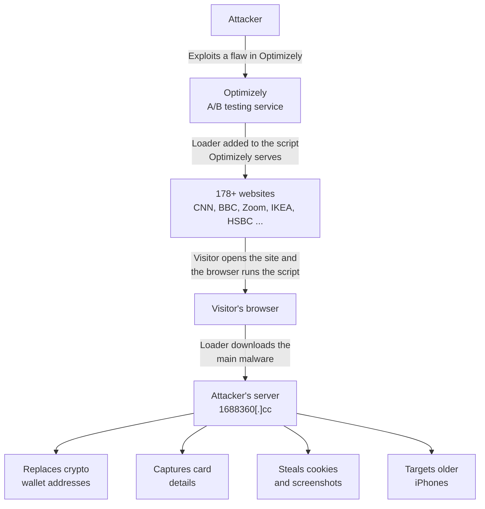
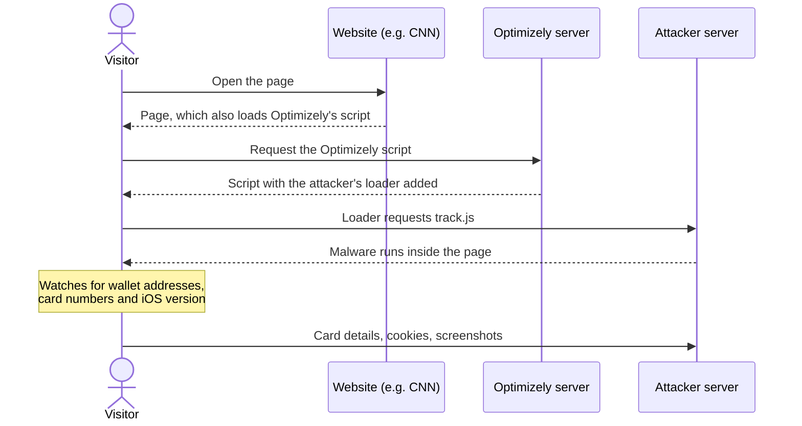
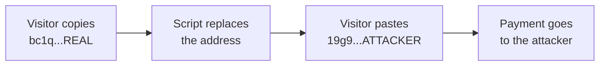
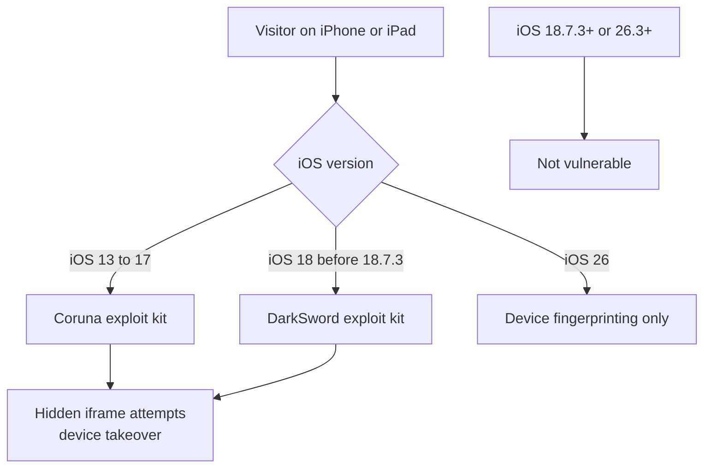

# Optimizely Supply-Chain Attack (November 2026)

- **Date:** 16 November 2026
- **Type:** Supply-chain attack, malicious JavaScript injection
- **Affected:** Visitors to at least 178 websites that use Optimizely, including CNN, BBC, Fox News, Zoom, IKEA, HSBC, Salesforce and Air France-KLM
- **Exposure window:** 04:21 to 23:11 UTC, about 19 hours (roughly 11 PM Sunday to 6 PM Monday, US Eastern)
- **Status:** Contained. How the attacker got in has not been fully disclosed.

## TL;DR

An attacker abused a vulnerability in Optimizely, an A/B testing service used by large websites, and added their own code to the script Optimizely delivers to those websites' visitors. For about 19 hours, anyone who opened one of the affected sites ran that code in their browser. It replaced cryptocurrency wallet addresses with the attacker's, captured card details typed into on-page forms, sent cookies and screenshots to the attacker, and tried to exploit older iPhones.

## What happened

Large websites use Optimizely to test changes, for example showing half their visitors a blue button and half a green one to see which gets more clicks. To do this, every page on the site loads a small script from Optimizely's servers, and the visitor's browser runs it automatically.

The attacker gained the ability to edit a setting in customers' Optimizely projects called Project JavaScript. Code placed there runs on every page of the customer's website. The attacker added a short loader to that field, and Optimizely's own servers (`cdn.optimizely.com`) then delivered it to visitors along with the normal script, under Optimizely's valid security certificate.

From the visitor's side nothing looked wrong. The site was the real site, the padlock in the browser was valid, and the script came from a vendor the site had chosen to trust. None of the 178 companies had their own servers broken into. They were affected because they all load code from the same supplier.

A simple way to picture it: many shops buy their price labels from the same printer. Someone breaks into the printer and changes the payment details on the labels. Every shop puts up the new labels as usual, and customers pay the wrong account. That is what a supply-chain attack is: compromise one shared supplier instead of each target individually.

## How the attack worked



What happened in the browser when someone opened an affected page:



## What the malicious code did

All of the following was in a single file, `track.js`, served to every visitor. The attacker rebuilt it 26 times during the day, adding features as they went.

### 1. Cryptocurrency address replacement



The script searched pages for wallet addresses for Bitcoin, Ethereum and other EVM chains, Solana, TRON, TON, Litecoin, Bitcoin Cash and Dogecoin, and replaced them with the attacker's addresses. It did this in page text, form fields, links, images, the clipboard, and outgoing network requests. Because wallet addresses are long random strings, few people notice a swap. Researchers traced roughly US $7,000 in stolen cryptocurrency.

### 2. Card skimming

Added at 13:43 UTC. The script watched form submissions for a valid card number, expiry date and CVV and sent them to `1688360[.]cc/card.php`. Cards entered in a payment provider's embedded frame (Stripe, Adyen and similar) were out of reach. Cards typed into a website's own form fields were not.

### 3. Cookie and screenshot theft

After replacing an address on a wallet or payment page, the script sent the attacker the page URL, the original address, a screenshot of the page, and any cookies the site had not marked HttpOnly. Cookies often hold login sessions, so this could let the attacker reuse a victim's logged-in session.

### 4. iOS exploitation



On iPhones and iPads, the script checked the iOS version and loaded a matching exploit kit inside a hidden iframe. Coruna and DarkSword are previously documented kits that chain several iOS vulnerabilities together, and both only work on devices that have not been updated. One visible side effect was that affected pages reloaded every 60 seconds on some older devices.

As of writing, no actual iPhone compromise has been confirmed. Researchers observed the exploits being delivered, not succeeding.

## Timeline

All times UTC on 16 November 2026 unless stated. Source: [Report URI](https://blog.report-uri.com/worlds-largest-brands-infected-with-malware-via-optimizely/), except where noted.

| Time | Event |
|---|---|
| 17 Sep | Same attacker's tooling first seen on Turkish websites |
| 9 Nov | Domain later used for the iOS attacks is registered |
| 13 to 16 Nov | Earlier, smaller wave delivered through other third-party scripts |
| 04:21 | First modified Optimizely script observed, on the BBC |
| 08:28 | `track.js` first seen running on bbc.com |
| 13:03 | Attacker begins moving stolen cryptocurrency to exchanges |
| 13:43 | Card skimming added |
| 17:13 to 17:57 | iOS targeting expanded |
| 19:24 to 19:59 | Report URI scans 1,611 Optimizely scripts and identifies the infections |
| 20:40 to 21:10 | Bulk cleanup of affected projects |
| 23:11 | All known infected scripts clean |
| 17 Nov, 00:37 | Attacker's main domain suspended |
| 17 Nov, 01:02 | Optimizely publishes an incident notice ([The Hacker News](https://thehackernews.com/2026/11/hijacked-optimizely-scripts-served-card.html)) |

## Affected organizations

Report URI checked 1,611 Optimizely scripts and found 188 infected, belonging to 178 organizations. The real number is probably higher because not every script could be checked.

| Sector | Count | Examples |
|---|---|---|
| Banking and finance | 32 | HSBC (multiple countries), Equifax, ABN AMRO, Paychex, TaxAct |
| Technology and SaaS | 23 | Zoom, Salesforce, GitLab, Bitly, Tableau, Smartsheet |
| Retail | 20 | IKEA, ASOS, Levi's, American Eagle, Mattel |
| Streaming and entertainment | 12 | Peacock, NOW TV, Starz, D&D Beyond |
| News and media | 10 | CNN, BBC, Fox News, NPR |
| Airlines and travel | 9 | Air France-KLM, Alaska Airlines, Hawaiian Airlines |
| Telecoms | 7 | Virgin Media O2, Vodafone Australia, TalkTalk |
| Crypto and trading | 6 | Ledger, IG, OANDA |
| Nonprofit | 4 | Change.org, UNICEF USA, ASPCA |

The full list is in [Report URI's write-up](https://blog.report-uri.com/worlds-largest-brands-infected-with-malware-via-optimizely/).

## Recommendations

### For users

- Update iPhones and iPads to iOS 18.7.3 or later, or iOS 26.3 or later (Settings > General > Software Update). This closes the vulnerabilities the exploit kits relied on.
- If you sent cryptocurrency through an affected site on 16 November, check that the destination address in the transaction matches the one you intended. When using a hardware wallet, confirm the address on the device's own screen.
- If you entered card details on an affected site that day, monitor your statements and consider requesting a replacement card.
- If you were logged in to an affected site, sign out of all sessions and change your password.
- If you only read pages and did not log in or pay, the practical risk is low.

### For website operators

- Review every Optimizely project's Project JavaScript and experiment code for anything you did not add. Search for `1688360`, `atob(` and `.icu`.
- Audit who and what can write to your Optimizely account, including users, API tokens and integrations, and rotate credentials.
- Treat card data entered in your own form fields on 16 November as exposed, and rotate any secrets stored in non-HttpOnly cookies.
- Deploy a Content Security Policy with restrictive `script-src` and `connect-src` directives, and avoid `unsafe-eval` where possible.
- Keep third-party scripts off checkout pages and collect card details through your payment provider's iframe.

Report URI checked the security policies of affected sites. Only about 15% had a Content Security Policy that blocked the malware, and 68 had none at all. HSBC's policy blocked the main payload, but a fallback copy embedded in the loader still ran because the policy allowed `unsafe-eval`. According to Report URI, Optimizely's documentation advises customers to allow that setting.

## Analysis

This incident shows how much trust websites place in third-party scripts. Each affected company had effectively given Optimizely permission to run code on its pages, so a compromise at Optimizely became a compromise of every site at once. Allow-listing a vendor's domain offered no protection here, since the malicious code came from that exact domain.

Damage was limited mainly because independent researchers spotted it quickly and it was cleaned up the same day. The stolen cryptocurrency was relatively small, but the same access could have been used for longer and less visibly.

## Attribution

No group has been named. Report URI links the activity to the same actor behind earlier, smaller injections on Turkish websites in September 2026 and through other third-party scripts on 13 to 16 November, and to a TRON wallet in use since March 2026. Security firm Cynet refers to the campaign as "OPTIMJACK".

Optimizely has said that "an unauthorized party exploited a vulnerability in the Optimizely Experimentation to add malicious JavaScript to some customer projects." It has not published technical details. BleepingComputer reports that the flaw was in the account signup flow.

## Glossary

| Term | Meaning |
|---|---|
| Supply-chain attack | Compromising a shared supplier in order to reach that supplier's customers |
| JavaScript | Code that websites send to the browser, which runs it automatically |
| A/B testing | Showing different versions of a page to different visitors to compare results |
| CDN | A network of servers that delivers website files to visitors |
| Card skimmer | Code that copies payment card details as they are entered |
| Clipboard hijacking | Altering copied content before it is pasted |
| Cookie | Data a website stores in the browser, often used to keep a user logged in |
| Exploit kit | A packaged set of attacks against known vulnerabilities |
| iframe | A page embedded inside another page, which can be made invisible |
| Content Security Policy (CSP) | A website setting that limits which scripts may run and where data may be sent |
| Indicator of compromise (IOC) | Technical evidence of an attack, such as a domain or file hash |

## Indicators of compromise

Domains are defanged.

| Indicator | Role |
|---|---|
| `1688360[.]cc` | Main command-and-control: serves `track.js`, receives `/card.php` and `/hit.php` |
| `webshell[.]lol` | Injector |
| `5vobauua3ojpklx[.]icu` | iOS router (`boot.js`) |
| `eil786npto9u5bq[.]icu` | Second iOS router (Coruna, iOS 26 chain) |
| `l7bcsnwc7nzr3uo[.]icu` | Coruna telemetry |
| `je4ft3gn8vxudum[.]icu`, `q1ls1ho9x7wsxlu[.]icu`, `ios-hack[.]icu` | Fallback command-and-control |

`track.js` SHA-256:

```
f7b84b9a94f749f8ced3f0112d0a66894e8bbc3b4aa5592021d1b8976a9bad40   latest build, 17:57 UTC
814a963c0da480e2449d9b6664480156e1cd6d731014117401bf635badec3a0f   17:13 UTC build
```

In-page markers: globals `window._k7` and `window.__k7b`; script attribute `data-channel-code="02111110"`.

Attacker wallets (partial):

```
BTC      19g9rZcPeiz8rUvyWpTRyXXhPnjsWrc3kW
ETH/EVM  0xC4026b06D82b0F0B363eda0642D61CfbDc17884e
```

The full list is in [Report URI's write-up](https://blog.report-uri.com/worlds-largest-brands-infected-with-malware-via-optimizely/).

## Conflicting reports

- **Entry point:** BleepingComputer says the flaw was in the signup flow. Optimizely's statement does not say.
- **Amount stolen:** Estimates range from about $6,600 (StepSecurity) to about $7,500 (Krebs on Security). Report URI puts it at $7,040 to $7,150.
- **iOS version ranges:** Report URI lists Coruna for iOS 13 to 17 and DarkSword for iOS 18. The Hacker News gives 13.0 to 17.2.1 and 18.4 to 18.7.

## Sources

- Report URI (Scott Helme), primary analysis: [World's Largest Brands Infected With Malware Via Optimizely](https://blog.report-uri.com/worlds-largest-brands-infected-with-malware-via-optimizely/)
- Krebs on Security: [Attackers Used Optimizely to A/B Test Malware on Top Websites](https://krebsonsecurity.com/2026/11/attackers-used-optimizely-to-a-b-test-malware-on-top-websites/)
- BleepingComputer: [Optimizely hack infected CNN, Fox News, BBC, Salesforce sites with malware](https://www.bleepingcomputer.com/news/security/optimizely-supply-chain-attack-delivers-malware-to-cnn-fox-news-bbc-salesforce-sites/)
- The Hacker News: [Hijacked Optimizely Scripts Served Card Skimmer and iOS Exploit Kits](https://thehackernews.com/2026/11/hijacked-optimizely-scripts-served-card.html)
- The Record: [Optimizely confirms hackers put malicious code into customer sites](https://therecord.media/optimizely-malicious-code-customer-sites)
- Malwarebytes: [CNN, BBC, Zoom, and other sites served malicious code in supply-chain attack](https://www.malwarebytes.com/blog/news/2026/11/cnn-bbc-zoom-and-other-sites-served-malicious-code-in-supply-chain-attack)
- Anadolu Agency: [Cyberattack hits 178 major global brands](https://www.aa.com.tr/en/world/cyberattack-hits-178-major-global-brands-exposing-visitors-to-data-theft/4127456)

---

Last updated 23 November 2026. Details may change as the investigation continues.

[Back to index](../../README.md)
